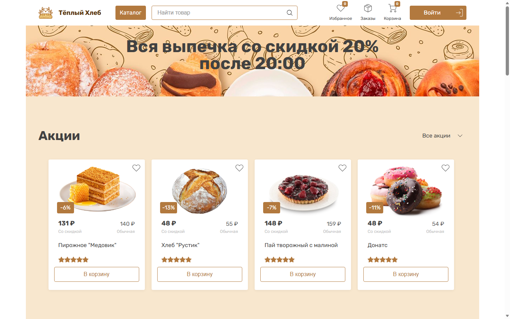

# Тёплый Хлеб — bakery online store

**[Live demo →](https://reatixx.github.io/bakery/)**



Multi-page website of a bakery with an online catalog. Graduation project (vocational college, web development).

## Features
- Product catalog rendered from data, with pagination
- Filters and search by product name
- Product card page: rating, reviews with star rating, quantity counter
- Favourites and cart counters in the header
- Login modal, burger menu for mobile
- Map with the shop location
- Lazy loading of images, responsive layout

## Stack
HTML5 · SCSS (BEM) · JavaScript (ES modules) · Vite · PostCSS · SVG sprite

## Run locally
```bash
npm install
npm run dev
```
